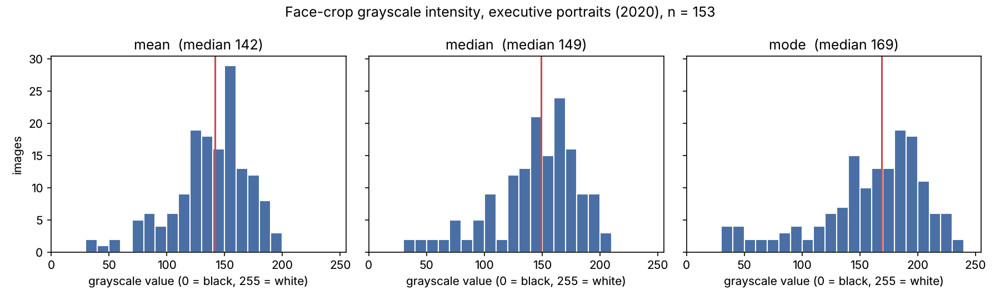

# Colorism Analysis

**Do the people who run the world's largest companies skew light-skinned, and can you measure
that from the photos the public sees of them?**

This project turns a portrait into a number: it finds the face, keeps the centre of it, and
summarises the grayscale intensity of those pixels. It was first run in 2020 on portraits of
the chief executives listed on Wikipedia, and the same command runs on any folder of photos,
including a labelled reference set such as FairFace, so the executive numbers can be put next
to a known mix of skin tones.

## Findings



The roster held 179 executives. 174 portraits were downloaded, and 153 produced a usable face
crop (the rest were too small, had no detectable face, or gave a crop that was mostly
background).

| Face-crop grayscale (0-255) | mean | median | mode |
| --- | ---: | ---: | ---: |
| median across portraits | 141.7 | 149.0 | 169.0 |
| interquartile range | 121.6-158.4 | 127-167 | 137-192 |
| standard deviation | 32.5 | 36.9 | 47.8 |
| skew | -0.86 | -0.91 | -0.98 |

- **The bulk sits in a narrow light band.** Half of the portraits have a mean face intensity
  between 122 and 158, and the distribution peaks around 150-160.
- **The dark end is a thin tail, not a second cluster.** 20 of 153 crops (13%) have a mean below
  100; the distribution is left-skewed on every measure rather than bimodal.
- **The mode separates faces the most.** Its spread (sd 47.8) is half again that of the mean,
  because it picks out the dominant skin tone and ignores shadows, eyebrows and teeth that
  pull the mean toward the middle.

What the number measures: luminance of a face crop, which carries skin tone together with the
lighting, exposure and editing of each photo. That is why the pipeline is built for
comparing distributions: run it unchanged on a reference set with known group labels (below)
and the executive distribution has a scale to be read against.

## How it works

1. **Roster.** [`data/executives.csv`](data/executives.csv) is the table from Wikipedia's
   [List of chief executive officers](https://en.wikipedia.org/wiki/List_of_chief_executive_officers)
   as of August 2020: company, executive, title, year appointed.
   [`scripts/fetch_roster.py`](scripts/fetch_roster.py) rebuilds it from the live page.
2. **Portraits.** [`scripts/fetch_portraits.R`](scripts/fetch_portraits.R) defines
   `fetch_portrait(query)`, which saves the first downloadable `.jpg` from a Bing Images search
   to `data/images/<query>.jpg`.
3. **Face crop.** [`colorism/faces.py`](colorism/faces.py) skips images under 120 px, runs
   OpenCV's frontal-face Haar cascade on a histogram-equalised grayscale copy, and keeps the
   central 60% of the face box in each dimension, which drops hair, ears and background.
4. **Statistics.** The colour crop is converted to grayscale and its nonzero pixels are
   summarised as mean, minimum, maximum, median and mode. A crop whose mean or mode is
   outside 30-230 is almost always a false detection and is discarded.
5. **Report.** [`colorism/report.py`](colorism/report.py) writes the summary table, the
   histograms above, and, given group labels, a per-group table and box plot.

## Getting images

**Executive portraits (the original study).** With R and the `rvest` and `tidyverse` packages:

```r
source("scripts/fetch_portraits.R")
roster <- readr::read_csv("data/executives.csv")
purrr::walk(utils::URLdecode(roster$Executive), fetch_portrait)
```

Look through `data/images/` afterwards and delete any result that is not a portrait of the
right person; image search gets a few wrong.

**FairFace (labelled reference set).** [FairFace](https://github.com/joojs/fairface) is a
face dataset balanced across seven race groups, released under CC BY 4.0
(Kärkkäinen and Joo, WACV 2021). From its README, download the *Padding = 0.25* image archive
(`fairface-img-margin025-trainval.zip`) and the validation labels (`fairface_label_val.csv`),
then unpack them so that you have `data/fairface/val/*.jpg` and
`data/fairface/fairface_label_val.csv`.

**Any folder of `.jpg` files** works the same way; name files however you like.

## Running it

```bash
python -m venv .venv && source .venv/bin/activate
pip install -r requirements.txt
pytest                                   # synthetic end-to-end test, no images needed

# executive portraits
python -m colorism data/images --title "Executive portraits"

# FairFace validation set, compared by race label
python -m colorism data/fairface/val --labels data/fairface/fairface_label_val.csv \
    --group race --out outputs/fairface
```

Each run writes to `outputs/` (or `--out`): `image_stats.csv` (one row per image),
`summary.csv`, `distributions.png`, and with `--group`, `by_<group>.csv` and `by_<group>.png`.
`--labels` takes any CSV with a column of image file names (`--file-col`, default `file`).

[`notebooks/walkthrough.ipynb`](notebooks/walkthrough.ipynb) runs the same steps
interactively: one image through detection and cropping, the whole folder, every crop placed
on the intensity scale, and the group comparison.

## Layout

```
colorism/            pipeline package (faces.py: detection and statistics; report.py: tables and figures)
  __main__.py        command line: python -m colorism
data/executives.csv  Wikipedia CEO roster, August 2020
figures/             figures shown in this README
notebooks/           walkthrough notebook
scripts/             roster and portrait download helpers
tests/               pytest suite with synthetic images
```

Written by W Yandell, with image scraping and the face-thumbnail plot by Abe Eyman.
